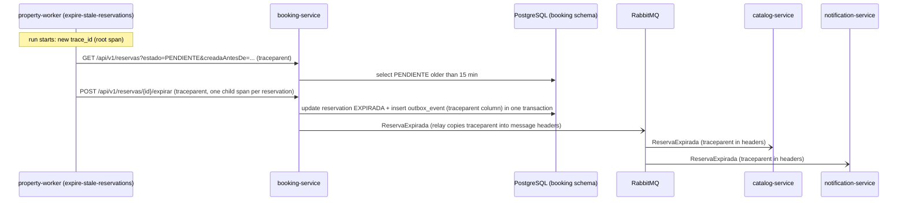

# CP1 · Journey: expire an unpaid reservation

A `Reserva` that stays `PENDIENTE` for more than 15 minutes keeps its dates locked.
With the orchestrated Saga that only happens when something broke (the workflow
stopped between two steps or a compensation failed), so the expiry is the safety net.
Nobody clicks anything: the job `expire-stale-reservations` of `property-worker` starts
the trace (ADR-014, E-19 in `07-api/contracts/booking-endpoint-fiches.md`).

## Hops

| Step | Caller | Callee | Protocol | Operation | Sync/Async | Data |
|---|---|---|---|---|---|---|
| 1 | `property-worker` (job `expire-stale-reservations`, every minute) | — | internal | starts a run, creates the root span | — | none |
| 2 | `property-worker` | `booking-service` (:3001) | REST | `GET /api/v1/reservas?estado=PENDIENTE&creadaAntesDe=<now-15min>&limit=<BATCH_SIZE>` | sync | `booking.reservation` (index `idx_reservation_pending_created_at`) |
| 3 ⚑ | `property-worker` | `booking-service` | REST | `POST /api/v1/reservas/{id}/expirar` (E-19), service token `svc-worker` | sync | `booking.reservation`, `booking.outbox_event` |
| 4 | outbox relay (`booking-service`) | RabbitMQ | AMQP | publish `ReservaExpirada` | async | `booking.outbox_event` |
| 5 | `catalog-service` | RabbitMQ | AMQP | consume `ReservaExpirada`, remove the range | async | `properties.unavailableRanges` |
| 6 | `notification-service` | RabbitMQ | AMQP | consume `ReservaExpirada`, tell the guest | async | `notification.delivery_log` |

⚑ Hop 3 is the hop of the CP9 drill: its downstream dependency is `booking-service`.

The worker calls Booking directly on the internal network, not through the gateway
(it is not a person's request). Booking owns the transition: `expirar` is valid only
from `PENDIENTE` (INV-002); `CONFIRMADA` or `CANCELADA` answer `422
INVALID_STATUS_TRANSITION`, which the worker counts and does not retry.

## Sequence

How the context travels:

- **Start:** the job has no caller, so each run creates a new `trace_id`. Every
  reservation expired in that run is a child span of the run.
- **HTTP:** `traceparent` header on both calls of the worker to Booking.
- **Async boundary:** the `ReservaExpirada` row in `booking.outbox_event` stores the
  `traceparent` of the `expirar` request. The relay, which runs later in another thread,
  copies it to the AMQP headers. Without that column, the trace would break at the
  outbox.

## Span tree

- `job expire-stale-reservations run` — property-worker (root)
  - `GET /api/v1/reservas` — booking-service
    - `select reservation` — booking-service (db)
  - `POST /api/v1/reservas/{id}/expirar` — booking-service (one per reservation)
    - `update reservation + insert outbox_event` — booking-service (db, one transaction)
- `relay publish ReservaExpirada` — booking-service (**crosses the async boundary**, same
  `trace_id`, parent = the `expirar` span)
  - `consume ReservaExpirada` — catalog-service
  - `consume ReservaExpirada` — notification-service
