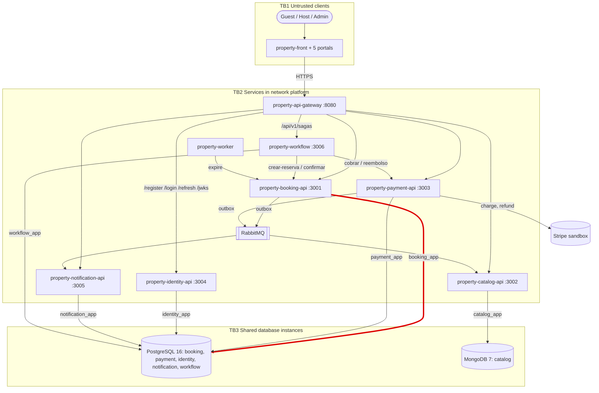

# CP1 — Attack surface of Property

Sources: property-docs 05-architecture/overview.md, 05-architecture/deployment.md and the
OpenAPI contracts in 07-api/contracts/. My boundary, in red: **booking-api -> PostgreSQL (schema booking)**.

## Assets of my boundary

| Asset | Where it lives | Classification |
|---|---|---|
| reservation rows (guest_id, property_id, dates, total_amount_cents, status) | booking.reservation | confidential |
| Password of booking_app | env/<environment>.env of property-infra-postgres (not versioned) | restricted |
| outbox_event payloads (ReservaCreada, ReservaConfirmada...) | booking.outbox_event | internal |
| idempotency keys of the Saga (<sagaId>:crear-reserva) | booking.idempotency_key | internal |
| Admin credential used by booking-db-migrate | env file of the runner (PG_ADMIN_USER, PG_ADMIN_PASSWORD) | restricted |

## Entry points of my boundary

| Entry point | Who calls it | Authentication today |
|---|---|---|
| postgres:5432 / database property | booking-api as booking_app | password from env; role booking_writer |
| postgres:5432, Liquibase runner | booking-db-migrate (runs once and exits) | instance admin; control tables databasechangelog_booking |
| Port 5432 in the network platform | any container in platform | not published to the host; password per user |
